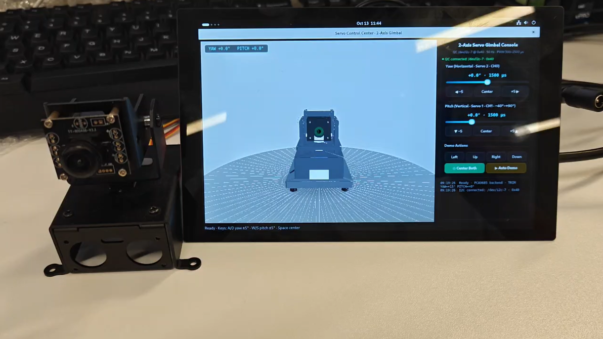
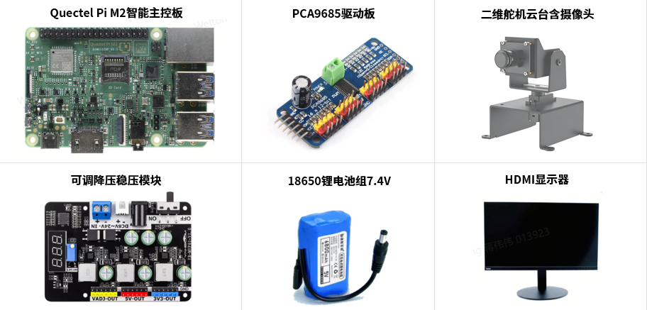
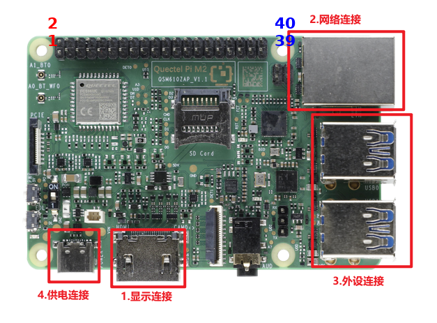

# 🎮 2-Axis Servo Gimbal Control

[中文](README_zh.md) | English

This project is a 2-axis servo gimbal control demo developed on the **Quectel Pi M2** smart main control board. A PCA9685 servo driver board is wired directly to the M2 40-pin header over I2C and drives the two LFD-01 servos of the gimbal — no expansion board and no UART protocol involved.

A PySide6 interface provides sliders, step buttons, keyboard shortcuts, one-click presets and an automatic demo, while an OpenGL 3D view follows the physical gimbal in real time, showing the complete control chain **"UI angle command → PWM pulse width → actual servo pose"**.



▶ **[Watch the demo video](assets/gimbal-demo.mp4)** (mp4, 23 MB)

Core Features:
- Drag the **Yaw** / **Pitch** sliders to aim the gimbal; the readout shows both the angle and the pulse width written to the PCA9685.
- The **OpenGL 3D view** follows the real gimbal, so the whole command chain can be watched on screen.
- **One-click presets, keyboard shortcuts and `▶ Auto Demo`** move the gimbal to known poses, which is convenient for demonstration and acceptance recording.

## 🎯 Key Features

- **Direct I2C drive**: PCA9685 (16 channels / 12-bit PWM) on `/dev/i2c-7` at address `0x40`, 50 Hz, pulse width 500–2500 µs ↔ 0–180°
- **Software motion smoothing**: the controller interpolates the pulse width towards the target at 50 Hz (150 ms travel by default), because the PCA9685 itself has no on-chip easing
- **Startup calibration**: the calibrated center position (mid-point + TRIM) is sent on start, so the gimbal centers itself on power-up
- **Synchronized 3D view**: a realistic OpenGL model (servo shells, U-bracket, camera module, studio floor) follows the virtual and the physical gimbal with eased motion
- **Simulation mode**: without `smbus2`, or with no PCA9685 answering on the bus, the interface keeps working normally and nothing is written to I2C
- **Robust I2C link**: the SLEEP bit is force-cleared on wake-up and re-cleared once per second (fixes "`i2cdetect` shows `0x40` but the servo never moves"), and a persistent handle is re-opened at a limited rate (0.3 s) after an error
- **Pose hold on exit**: PWM is not zeroed on close, so the gimbal keeps its last pose

## 🖥️ Interface Overview

The interface consists of two primary areas: the **3D view** on the left and the **control panel** on the right.

- 🧊 **3D View**: servo shells, U-bracket, camera module and studio floor, animated together with the hardware
- 📊 **Connection Status**: green `● I2C connected: /dev/i2c-7 · 0x40` when the chip answers, amber `○ Simulation mode` otherwise
- 🎚️ **Yaw / Pitch Controls**: sliders over −90° ~ +90° and −40° ~ +90° with an angle + pulse width readout, plus `−5 / Center / +5` step buttons
- 🎮 **Demo Actions**: `Left / Up / Right / Down` presets, `◎ Center Both`, `▶ Auto Demo`, and the log window below

## ⚙️ Working Principle

### Angle ↔ Pulse Width Mapping

An angle of `−90° ~ +90°` is mapped onto the servo angle `0° ~ 180°` (0° = mid-point) and then onto the pulse width:

```
servo angle = angle + 90
pulse width = 500 + servo angle / 180 × 2000   (µs)
```

| Axis | Servo | Channel | Range | Notes |
| --- | --- | --- | --- | --- |
| Yaw (horizontal) | Servo 2 | CH0 | −90° ~ +90° | 0° = center |
| Pitch (vertical) | Servo 1 | CH1 | −40° ~ +90° | 130° travel; +90° points straight up |

### Smoothing and Startup Calibration

The PCA9685 only holds the last value written to it, so a background writer approaches the target pulse width at 50 Hz instead of jumping, and it writes a register only while a value actually changes. On start the controller immediately sends the calibrated center position, so the gimbal is centered as soon as the program runs.

### SLEEP Self-healing and Fault-tolerant Bus

`MODE1.SLEEP` is `1` after reset, which stops the internal oscillator and produces no PWM at all — the classic "`i2cdetect` shows `0x40` but the servo never moves". The driver therefore clears the SLEEP bit unconditionally on wake-up and keeps the chip awake once per second, and it re-opens the I2C handle at a limited rate (0.3 s) after an error, so a disturbed bus recovers by itself.

## 📋 System Requirements

### Hardware Requirements

| Accessory | Qty | Specifications |
| --- | --- | --- |
| Quectel Pi M2 smart main control board | 1 | Factory image: Debian 13, no flashing required |
| PCA9685 servo driver board | 1 | 16 channels / 12-bit PWM / I2C, default address `0x40`, separate VCC and V+ rails |
| 2-axis camera servo gimbal | 1 | LFD-01 servos ×2 (brown/red/orange = GND/5V/signal), 4.8–6.0 V supply |
| Dual-output buck regulator module | 1 | Fixed 5 V output + adjustable output; total ≥5 A, servo rail ≥2 A |
| 18650 battery holder (2S) | 1 | 7.4 V output; a 6–24 V DC supply works too |
| Display (optional) | 1 | HDMI monitor; not needed when developing over SSH |



### Software Requirements

- Operating System: Debian 13 (Quectel Pi M2 default system image), Python 3
- An isolated environment with the pinned dependencies in `requirements.txt`: PySide6 6.11.2, pyqtgraph 0.14.0, numpy 2.5.3, PyOpenGL 3.1.10 and `smbus2` 0.4.3 (optional — without it the program runs in simulation mode)

## 🔌 Hardware Connection



1. **Logic and I2C (M2 40-pin → PCA9685)**: 3.3 V → **Pin1/VCC**, GND → **Pin9/GND**, SDA → **Pin27/SDA**, SCL → **Pin28/SCL** (M2 `/dev/i2c-7`; Pin3/5 stay free for the display).
2. **Power chain**: battery → regulator IN+/IN−; the regulator **fixed 5 V** output back-feeds the M2 through **Pin2/Pin4** (replacing Type-C); the **adjustable** output (5.0–5.5 V, ≥2 A) feeds PCA9685 **V+** for the servos.
3. **Common ground**: regulator GND, M2 **Pin9** and PCA9685 GND must be one single node — **I2C fails without it**.
4. **Servos**: the yaw servo goes to **CH0** and the pitch servo to **CH1**; both power wires are connected in parallel to V+/GND. LFD-01 wire order is **brown / red / orange = GND / 5 V / signal** — reversing it burns out the servo.

> **Tips**: keep VCC (logic, a few mA) and V+ (servo power, ≥1 A) on separate rails · never connect Type-C and the 40-pin 5 V back-feed at the same time · an **OE** pin must be tied to **GND** · after wiring, `i2cdetect -y 7` should show `0x40`.

## 🚀 Installation & Execution

The **Quectel Pi M2** ships with a **Debian 13** system image, so no flashing is needed — just follow the steps below.

1. Clone the project and create an isolated environment inside it.

```bash
sudo apt update
sudo apt install -y git
git clone https://github.com/Quectel-Pi/demo-servo-gimbal-control.git
cd demo-servo-gimbal-control
python3 -m venv .venv
.venv/bin/pip install -r requirements.txt
```

2. Run the program; the graphical interface appears when the deployment is complete.

```bash
python3 run_gimbal.py
```

`run_gimbal.py` locates the environment inside the project (`.venv` or `venv`), fills in `DISPLAY` and the Xwayland authorization token when running over SSH/Wayland, and then starts `src/main.py`. The **Servo Control Center · 2-Axis Gimbal** window shows the 3D view on the left and the control panel on the right.

### Enable Auto-start at Boot (Optional)

Set `Exec` and `Path` in `deploy/demo-servo-gimbal-control.desktop` to your project location, then install it:

```bash
mkdir -p ~/.config/autostart
cp deploy/demo-servo-gimbal-control.desktop ~/.config/autostart/
```

## 🎛️ Usage Instructions

1. **Start**: the controller connects to `/dev/i2c-7` and sends the calibrated center position.
2. **Aim**: drag the Yaw / Pitch sliders, or use the step buttons and the keyboard.
3. **Observe**: the 3D view follows the gimbal while the readout shows the pulse width in µs.
4. **Demo**: `▶ Auto Demo` sweeps 3 sine cycles (yaw ±50°, pitch ±35°) from the current pose and returns exactly to it.

| Control | Function |
| --- | --- |
| Drag the Yaw / Pitch sliders | Absolute angle control |
| `◀ −5 / Center / +5 ▶` | Yaw step / center |
| `▼ −5 / Center / +5 ▲` | Pitch step / center |
| Keyboard `A` / `D` | Yaw ±5° |
| Keyboard `W` / `S` | Pitch ±5° |
| Keyboard `Space` / `◎ Center Both` | Center both axes |
| `Left / Up / Right / Down` | One-click preset poses |
| `▶ Auto Demo` | Automatic demo (3-cycle sweep) |

## 📁 Project Structure

```
demo-servo-gimbal-control/
├── README.md                            # English documentation (this file)
├── README_zh.md                         # Chinese documentation
├── requirements.txt                     # Python dependencies
├── run_gimbal.py                        # Launcher: locates the venv, fixes DISPLAY/XAUTHORITY, starts the app
├── assets/                              # Screenshots, photos and the demo video
├── deploy/
│   └── demo-servo-gimbal-control.desktop  # Desktop entry for autostart on the M2
└── src/                                 # Source code
    ├── main.py                          # Qt application entry point
    ├── controller/
    │   └── gimbal_controller.py         # Angle ↔ pulse width mapping, TRIM calibration, 50 Hz soft stepping
    ├── driver/
    │   └── pca9685.py                   # PCA9685 I2C driver: wake-up, keep-awake, auto re-open, simulation fallback
    ├── ui/
    │   └── main_window.py               # Main window, status bar, keyboard shortcuts
    └── widgets/
        ├── opengl_servo_view.py         # Realistic OpenGL 3D gimbal view
        └── servo_panel.py               # Control panel: sliders, buttons, presets, auto demo, log
```

## 🛠️ Configuration Parameters

| Parameter | Default | Description |
| --- | --- | --- |
| `YAW_SERVO` / `PITCH_SERVO` | `0` / `1` | PCA9685 channel of each axis (CH0 = yaw, CH1 = pitch) |
| `PITCH_MIN` / `PITCH_MAX` | `-40.0` / `90.0` | Pitch travel limits in degrees (130° in total) |
| `YAW_TRIM` / `PITCH_TRIM` | `15.0` / `0.0` | Center compensation in degrees (positive = right / upwards), calibrated on the reference hardware |
| `TICK_S` / `dur_ms` | `0.02` / `150` | Soft-stepping period (50 Hz) and travel time of one move in milliseconds |
| `bus` / `addr` / `freq` | `7` / `0x40` / `50.0` | I2C bus, PCA9685 address and PWM frequency |

The first four are defined at the top of [src/controller/gimbal_controller.py](src/controller/gimbal_controller.py), the last one in the `PCA9685` constructor in [src/driver/pca9685.py](src/driver/pca9685.py).

## ❓ FAQ

| Symptom | Solution |
| --- | --- |
| `Simulation mode (no PCA9685 on /dev/i2c-7)` | Check that V+ reads 5.0–5.5 V, that `ls /dev/i2c-7` and `i2cdetect -y 7` work, that SDA/SCL are not swapped, that the common ground is good, and that `smbus2` is installed |
| `i2cdetect` shows no address at all | Check the bus, the SDA/SCL order and above all the **common ground** — with the power off, a multimeter on the buzzer range between M2 Pin9 and the regulator GND should beep (≈0 Ω); with power on the adjustable output should read a steady 5.0–5.5 V |
| The servo is stiff but never moves | Usually the PCA9685 is in SLEEP; the driver clears the SLEEP bit on wake-up and once per second, so just restart the program. If it still does not move, check that the **OE** pin is grounded |
| The servo jitters or makes noise | Add a 1000 µF electrolytic capacitor across V+/GND, and keep the adjustable output within 5.0–5.5 V |
| Only one axis moves | Check the signal wire of the corresponding channel (CH0 = yaw, CH1 = pitch) and that servo's power wires (measure V+/GND) |
| The gimbal is not centered after start | Adjust `YAW_TRIM` / `PITCH_TRIM` in [src/controller/gimbal_controller.py](src/controller/gimbal_controller.py) and restart the program |

## Reporting Issues

If you encounter any issues while using this demo, you are welcome to submit a technical inquiry on the [Quectel official forum](https://forums.quectel.com/). Our technical support team will reply promptly.

Feel free to submit Issues to report problems or Pull Requests to contribute code improvements.
